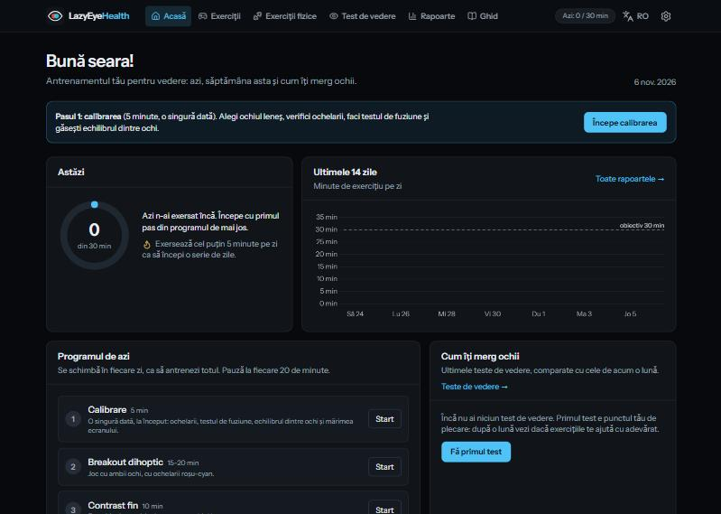
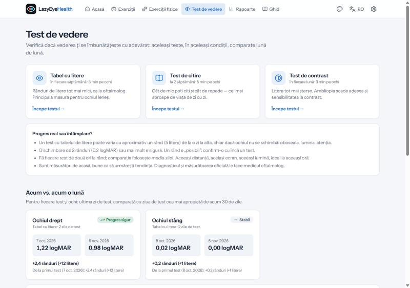
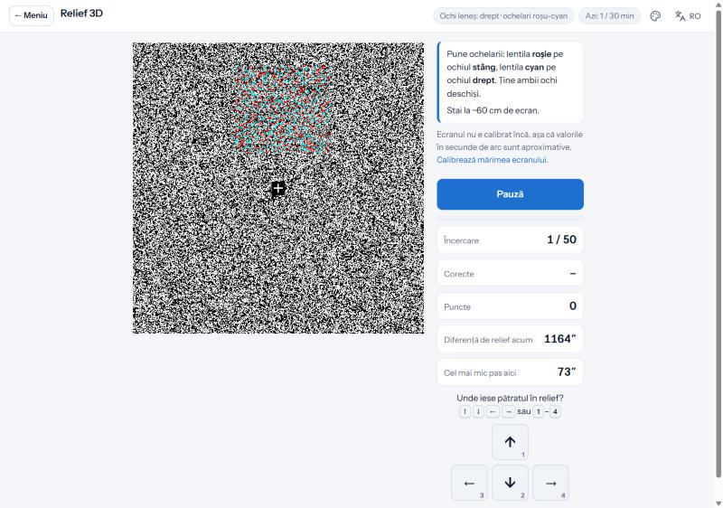
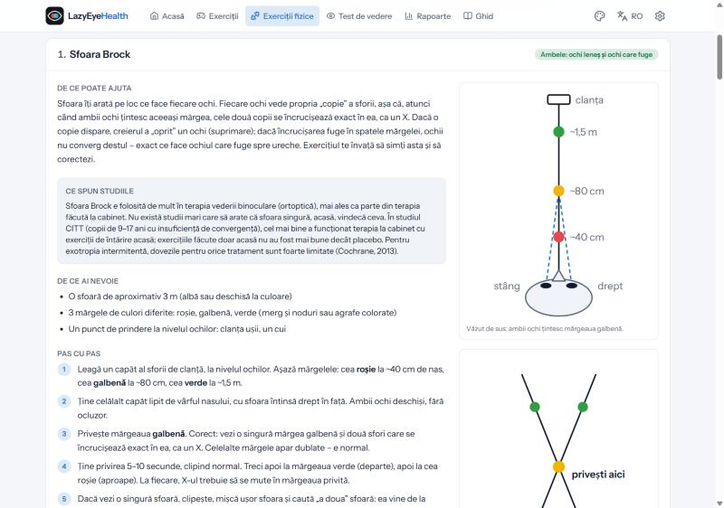
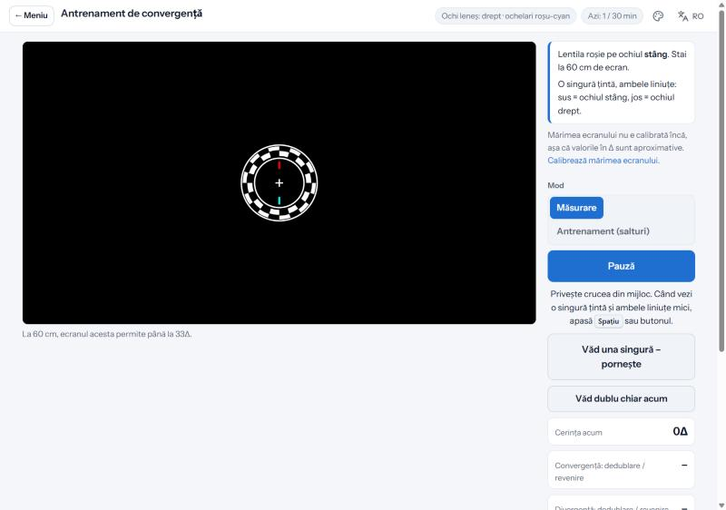

# LazyEyeHealth

A personal web app for training the vision of an **amblyopic ("lazy") eye** and for **divergent strabismus** (an eye that drifts outward): games with both eyes through red-cyan glasses, precision exercises for the lazy eye, depth and convergence training, physical exercises with drawings, daily progress, reports and **home vision tests compared month by month** — so you can see whether the vision really improves.

It is the second version of the static `Exercitii-ambliopie` pages: the same exercises, now in **Laravel + Vue**, with an account, data saved in a database, Romanian and English, and colour themes.

> **Medical note.** The exercises complement the treatment prescribed by an eye doctor; they do not replace it. Stop if you get double vision that stays, a headache or dizziness. Ask the doctor before fusion / convergence exercises, especially if the eye drifts all the time.



## Features

| Module | What it does |
| --- | --- |
| **Home** | Today's minutes vs. the daily goal (progress ring), run of days, last 14 days chart, **today's program** (a different game and precision exercise every day, relief / convergence on alternate days, calibration and weekly-test reminders), how the eyes are doing (latest vision tests vs. one month before), daily journal (patching minutes outside the app, eye comfort 1–5, note). |
| **Exercises — both eyes** | **Dichoptic Tetris, Breakout, Snake** with red-cyan glasses: the lazy eye sees the moving pieces at full contrast, the good eye sees the rest at reduced contrast, so you can only play when the eyes work together. The good eye's contrast goes up automatically as you progress (auto-balance). |
| **Exercises — lazy eye** | Perceptual learning with adaptive difficulty (staircase): **Fine contrast** (Gabor stripes), **Letter E** (with / without neighbouring letters — crowding), **Aligned lines** (vernier hyperacuity), **Open ring** (search against the clock), **Reading with the lazy eye** (short texts in smaller and smaller print, reading speed). |
| **Depth and strabismus** | **3D relief**: random-dot stereograms, stereo threshold in seconds of arc. **Convergence training**: break / recovery measured in prism dioptres and jump training, with suppression marks for each eye and safety rules based on the Worth test. |
| **Physical exercises** | Off-screen exercises explained with drawings: Brock string, pencil push-ups (near point of convergence measured and charted), printable barrel card, near–far focusing, patching with near activities, control of the drifting eye, 20-20-20 breaks; timer, what the studies say, when to stop. |
| **Calibration** | Lazy eye, glasses check and lens colours, Worth 4-dot fusion test, balance between the eyes, screen size with a bank card, viewing distance. |
| **Vision test** | **Letter chart** (Sloan letters, ETDRS letter-by-letter score in logMAR, decimal and Snellen), **reading test** (reading acuity, best reading speed, critical print size), **contrast test** (Pelli-Robson style, dithered contrast). Per eye; **now vs. one month ago** and since the first test, with a verdict that respects the measurement error (2 lines = sure change). |
| **Reports** | Period filter (7 / 30 / 90 / 365 days, all, or a month), totals, days with practice and with the goal reached, minutes per day by kind of exercise with the goal line, calendar, time per exercise, how every exercise evolves (one chart each), vision tests and journal notes; **CSV export** for Excel. |
| **Guide** | Recommended program, amblyopia and strabismus, safety, how it works, what the studies say, what you need, sources. |
| **Settings** | Theme, lazy eye, glasses or patch, red lens side and second lens colour, good-eye contrast and auto-balance, daily goal, break reminder, sounds, calibration state, password (live). |
| **Languages and themes** | **Romanian** (default) and **English**, **light** (default), **light blue** and **dark** themes — both switched from the top right of every page. The exercise canvas stays black in every theme: red-cyan glasses separate the two pictures only on black. |
| **Login** | Locally no login page (you are the admin automatically); on the live server login is always required. |

<p>
  
  
</p>
<p>
  
  
</p>

## Tech stack

- **PHP 8.5**, **Laravel 13** — SQLite locally, MySQL on the live server
- **Inertia 3** + **Vue 3.5** (Options API) + **TypeScript**: one application, no separate API for the pages
- **Tailwind CSS 4**, Lucide icons, **Chart.js**, Vite+ (`npm run build`), Laravel Wayfinder
- Exercises: canvas modules in plain TypeScript (`resources/js/exercises/*.ts`) run inside Vue pages, with the shared **Amb** helpers (colours per eye, screen geometry, adaptive staircase, practice time, results)
- Quality: **PHPUnit** feature tests, **Pint**, `vue-tsc`

## Project structure

```
app/
├── Enums/                  Eye, VisionTestType (labels, Vue page, measurement error)
├── Http/
│   ├── Controllers/        Thin controllers: Dashboard, Exercise, Practice, ExerciseResult, VisionTest,
│   │                       Report, Settings, Journal, Locale, Auth/Login, Auth/Register
│   ├── Middleware/         SetLocale, AutoLoginLocally (no login locally), HandleInertiaRequests
│   └── Requests/           Form Requests (validation rules)
├── Models/                 User, UserSetting, PracticeLog, ExerciseResult, VisionTest, JournalEntry
├── Services/               Business logic
│   ├── SettingsService     defaults + saved settings, validation rules
│   ├── ProgressService     practice seconds, days, streaks, exercise summaries
│   ├── DailyPlanService    "today's program"
│   ├── ReportService       report data and CSV
│   └── VisionProgressService  day averages, "now vs. one month ago", verdicts
└── Support/                ExerciseCatalog (all exercises in one place), AuthMode
config/eye.php              Login on/off, admin user, default settings, streak and heartbeat limits
database/migrations/        user_settings, practice_logs, exercise_results, vision_tests, journal_entries
lang/                       ro.json (Romanian of the server texts) + ro/*.php (validation messages)
resources/
├── css/                    app.css (themes as CSS variables), amb.css (exercise pages)
└── js/
    ├── amb/                Shared exercise helpers (settings, colours per eye, geometry, staircase,
    │                       results, practice time + break reminder, pop-ups, sounds)
    ├── exercises/          One module per exercise + runtime.ts (clean-up when leaving a page)
    ├── vision/             Sloan letters, reading sentences, saving the vision tests
    ├── pages/              Inertia pages: Dashboard, exercises/*, physical/, vision/*, reports/,
    │                       settings/, Guide, auth/*
    ├── components/         charts/, exercise/, general/, layout/, physical/, vision/
    ├── layouts/            AppLayout (menu bar)
    ├── i18n/               t() / $t(), Romanian dictionaries in ro/*.ts
    └── utils/              charts, themes, formats, metrics, navigation
tests/Feature/              159 tests (see below)
docs/                       Detailed documentation (see below)
start-local.bat             Prepares and starts the app locally (port 8040)
```

## Conventions

- Code, comments, documentation and translation keys are in **English**; the Romanian texts (the default language) live in `lang/ro.json` and `resources/js/i18n/ro/*.ts`.
- Business logic in **services**, validation in **Form Requests**, controllers stay thin.
- Days are stored as `YYYY-MM-DD` text in the app's time zone (`Europe/Bucharest`), identical in SQLite and MySQL.
- Colours only through the theme variables (`bg-panel`, `text-muted`, …); charts read them too, so they follow the theme.
- Exercise modules use the runtime (`rt.timeout`, `rt.on`, `rt.raf` …) instead of raw timers and listeners, so nothing keeps running after you leave the page.

## Local setup (XAMPP on Windows)

**The easy way:** double-click `C:\Users\brand\Desktop\work\start_lazyeyehealth.bat` (it calls `start-local.bat` in the project). The first time it installs what is missing (Composer and npm packages, `.env` in local mode, the SQLite database with the admin); every time it runs new migrations, builds the app, starts the server on **port 8040** in a minimized window and opens http://127.0.0.1:8040. Apache, MySQL and the other projects are not touched; close the "LazyEyeHealth server" window to stop it.

**By hand:** requires PHP 8.5 (`pdo_sqlite`, `intl`, `mbstring`), Composer 2, Node 26+.

```bash
composer install
cp .env.example .env            # then set AUTH_ENABLED=false and ADMIN_PASSWORD for local use
php artisan key:generate
php artisan migrate --seed       # tables + the admin user from .env
npm install
npm run build                    # or "npm run dev" for hot reload
php artisan serve --port=8040
```

The `.php-version` file (8.5.12) is read by `C:\xampp\bin\php.bat`, so `php artisan …` in this folder always uses the right PHP. The project also appears in `switch_project.bat` (XAMPP Apache on http://localhost), like the other Laravel projects in the `work` folder.

## Configuration (`.env`)

| Setting | Local | Live | What it does |
| --- | --- | --- | --- |
| `APP_ENV` | `local` | `production` | The login page is skipped only when `APP_ENV=local` **and** `AUTH_ENABLED=false` |
| `AUTH_ENABLED` | `false` | `true` | Login page on / off (always on in production) |
| `REGISTRATION_ENABLED` | `false` | `false` | Allow new accounts from the login page |
| `ADMIN_NAME`, `ADMIN_EMAIL`, `ADMIN_PASSWORD` | | | Admin created by `php artisan db:seed` (and locally on the first visit) |
| `APP_LOCALE` | `ro` | `ro` | Default language |
| `APP_TIMEZONE` | `Europe/Bucharest` | same | Decides which day the practice time belongs to |
| `DB_CONNECTION` | `sqlite` | `mysql` | Database (`DB_HOST`, `DB_DATABASE`, … for MySQL) |

## Putting it live (checklist)

Nothing is deployed automatically. When you decide to:

1. Server with PHP 8.5, MySQL, a web server pointing to `public/`, HTTPS.
2. `git clone` this repository, create `.env` with `APP_ENV=production`, `APP_DEBUG=false`, the MySQL settings, `AUTH_ENABLED=true`, a strong `ADMIN_PASSWORD`, `SESSION_SECURE_COOKIE=true`.
3. `composer install --no-dev --optimize-autoloader`, `php artisan key:generate`, `php artisan migrate --force`, `php artisan db:seed --force`, `npm ci && npm run build`, `php artisan optimize`.
4. More users: `php artisan app:user ana@example.com --name="Ana"` (asks for the password).

Details: [docs/setup.md](docs/setup.md).

## Verifying changes

```bash
php artisan test          # 159 PHPUnit feature tests (in-memory SQLite, ~6 s)
vendor/bin/pint           # PHP code style
npx vue-tsc --noEmit      # TypeScript check of the Vue / TS code
npm run build             # build the app
```

| Test file | What it guards |
| --- | --- |
| `tests/Feature/AuthTest.php` | Login required live, local auto-login (first visit opens the requested page), wrong password and lock after 5 tries, logout, registration switch |
| `tests/Feature/PagesTest.php` | Every page and every exercise renders with the right Vue page and data; unknown pages give 404 |
| `tests/Feature/PracticeAndResultsTest.php` | Practice seconds per day, limits per call, results stored and cleaned, journal |
| `tests/Feature/SettingsTest.php` | Defaults, validation, normalised types, password change |
| `tests/Feature/VisionTestsTest.php` | Vision tests saved with all details, monthly comparison (baseline, averages, verdicts), only the owner can change them |
| `tests/Feature/ProgressTest.php` | Streaks, days without practice, today's program |
| `tests/Feature/ReportsTest.php` | Periods, report data, CSV export (BOM, `;`, Romanian header) |
| `tests/Feature/LocaleTest.php` | Romanian by default, RO / EN switch, translated catalog and messages |

## Documentation

| File | Contents |
| --- | --- |
| [docs/README.md](docs/README.md) | Overview of the project |
| [docs/setup.md](docs/setup.md) | Local run, live checklist, tests, useful commands |
| [docs/database.md](docs/database.md) | Tables, columns, JSON keys, diagram |
| [docs/backend.md](docs/backend.md) | Routes, controllers, models, services, middleware, configuration |
| [docs/frontend.md](docs/frontend.md) | Vue pages, layouts, components, Amb helpers, i18n, themes, charts, how to add an exercise |
| [docs/exercises.md](docs/exercises.md) | Every exercise: what it trains, how it works, what it saves |
| [docs/vision-tests.md](docs/vision-tests.md) | The three vision tests, their scoring and the monthly comparison |

## Sources

The exercises and the vision tests follow published methods; the app says honestly what the evidence supports.

- National Eye Institute — [Amblyopia (lazy eye)](https://www.nei.nih.gov/learn-about-eye-health/eye-conditions-and-diseases/amblyopia-lazy-eye)
- American Academy of Ophthalmology — [Amblyopia Preferred Practice Pattern 2022](https://www.aao.org/preferred-practice-pattern/amblyopia-ppp-2022)
- Cochrane 2022 — [Binocular versus standard occlusion or blurring treatment for unilateral amblyopia](https://www.cochranelibrary.com/cdsr/doi/10.1002/14651858.CD011347.pub3/information)
- Levi & Li 2009 — [Perceptual learning as a potential treatment for amblyopia](https://pmc.ncbi.nlm.nih.gov/articles/PMC2764839/)
- Ding & Levi 2011, PNAS — [Recovery of stereopsis through perceptual learning in adults](https://pmc.ncbi.nlm.nih.gov/articles/PMC3174650/)
- Rosser et al. 2003, BJO — [How sensitive to clinical change are ETDRS logMAR visual acuity measurements?](https://pubmed.ncbi.nlm.nih.gov/12882770/)
- Cochrane — [Interventions for convergence insufficiency (CITT)](https://www.cochrane.org/evidence/CD006768_how-do-different-treatments-vision-disorder-convergence-insufficiency-compare-effectiveness)
- Cochrane 2013 — [Interventions for intermittent exotropia](https://pubmed.ncbi.nlm.nih.gov/23728647/)

## Useful commands

```bash
php artisan migrate:fresh --seed            # empty database + admin (deletes all data!)
php artisan app:user email --password=...   # create a user / change a password
php artisan route:list --except-vendor      # all routes
npm run build                               # build the Vue app into public/build
```
