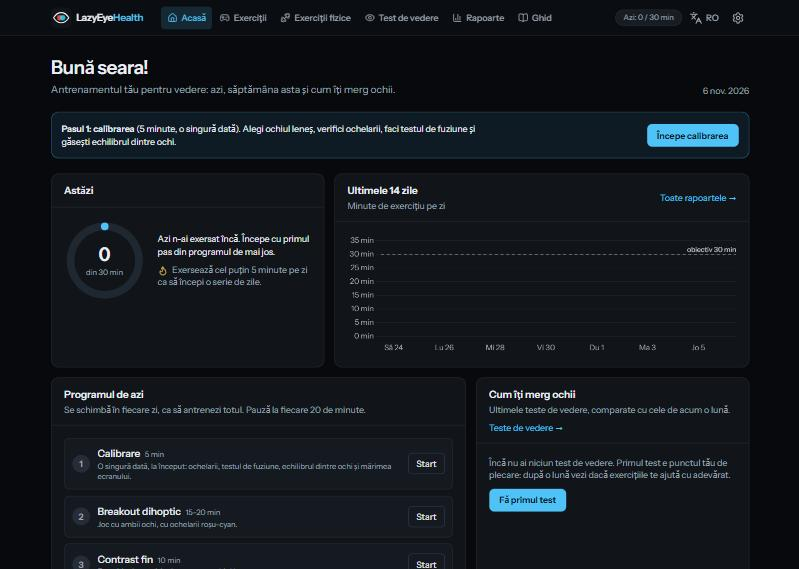
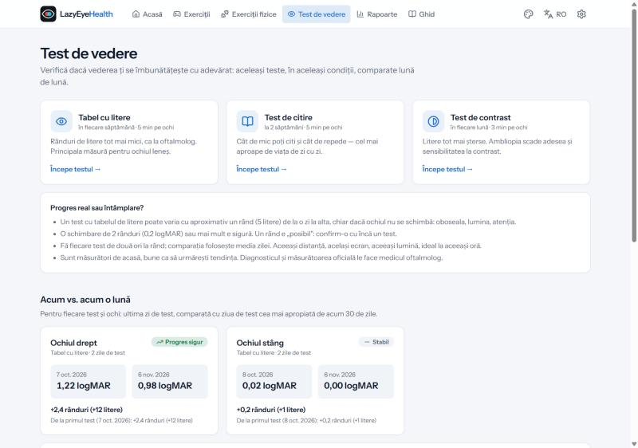
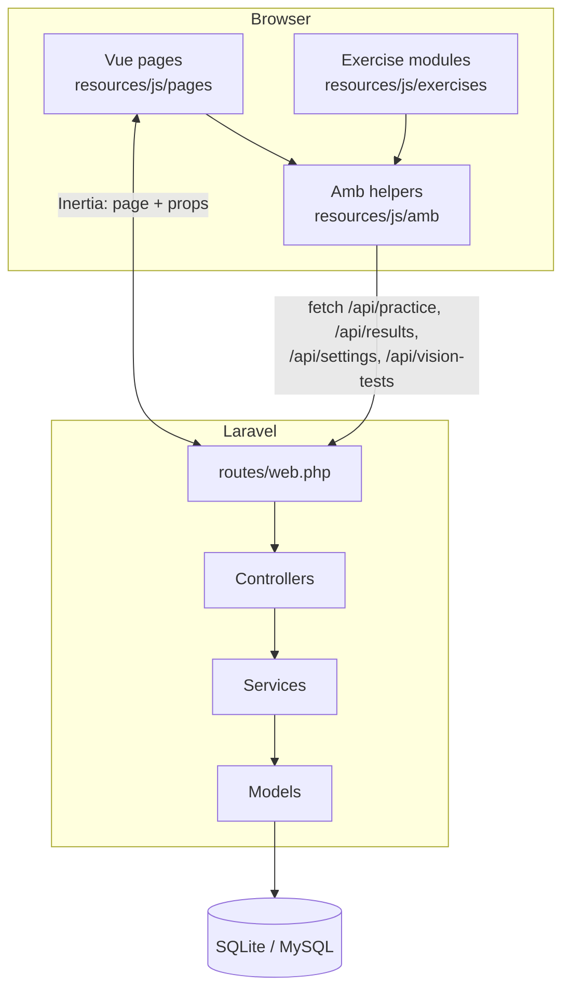

# LazyEyeHealth — project overview

A personal web app for training the vision of an **amblyopic ("lazy") eye** and for **divergent strabismus** (an eye that drifts outward), with daily progress, reports and home vision tests that show whether the vision really improves.

It is the second version of the static `Exercitii-ambliopie` pages: same exercises, now in **Laravel + Vue**, with an account, data saved in a database, two languages and colour themes.

> The app complements the treatment prescribed by an eye doctor; it does not replace it.

## What it does

| Area | What you get |
|---|---|
| **Home** | Today's minutes vs. the daily goal, run of days, last 14 days, today's program (changes every day), vision progress, a daily journal (patching outside the app, how the eyes felt) |
| **Exercises** | Games with both eyes through red-cyan glasses (Tetris, Breakout, Snake), precision exercises for the lazy eye (contrast, letter E, aligned lines, open ring, reading), 3D relief (stereo), convergence training for strabismus, calibration |
| **Physical exercises** | Off-screen exercises with explanations and drawings: Brock string, pencil push-ups (with the near point of convergence measured), barrel card, patching, near–far focusing |
| **Vision test** | Letter chart (ETDRS scoring), reading test (smallest print + reading speed), contrast test (Pelli-Robson style); **now vs. one month ago** per eye with a verdict that takes the measurement error into account |
| **Reports** | Minutes per day by kind of exercise, calendar, goal days, time per exercise, how every exercise evolves, vision tests and notes of a period; CSV export |
| **Guide** | Recommended program, amblyopia and strabismus, safety, how it works, what studies say, sources |
| **Settings** | Theme (light / light blue / dark), lazy eye, glasses or patch, lenses, good-eye contrast, daily goal, breaks, sounds, password |

Top right on every page: **language** (Română / English) and **theme**.

*Vision test page with example data: the 3 tests and the comparison with one month before.*

## Technology

Same stack as the ERP demo project:

- **Laravel 13** (PHP 8.5) — routes, controllers, validation, services, database
- **Inertia v3** — Laravel sends the name of a Vue page and its data; no separate API for pages
- **Vue 3** (Options API) + **TypeScript**, **Tailwind CSS 4**, **Chart.js**, **Lucide** icons
- **SQLite** locally, **MySQL** live
- Canvas exercises in plain TypeScript modules (`resources/js/exercises/*.ts`) run inside Vue pages

## Login

- **Locally** (`APP_ENV=local` and `AUTH_ENABLED=false` in `.env`): no login page, you are the admin user automatically.
- **Live**: the login page is always required; the admin is created from `.env` (`ADMIN_EMAIL`, `ADMIN_PASSWORD`); more users with `php artisan app:user`.

## Documentation

| File | Contents |
|---|---|
| [setup.md](setup.md) | Run locally, put it live, tests, useful commands |
| [database.md](database.md) | Tables, columns, JSON keys, diagram |
| [backend.md](backend.md) | Routes, controllers, models, services, middleware, configuration |
| [frontend.md](frontend.md) | Vue pages, layouts, components, the Amb helpers, i18n, themes, charts, how to add an exercise |
| [exercises.md](exercises.md) | Every exercise: what it trains, how it works, what it saves |
| [vision-tests.md](vision-tests.md) | The three vision tests, their scoring and the monthly comparison |

## Conventions

- Code, comments, documentation and translation keys are in **English**. Romanian (the default language) lives in `lang/ro.json` and `resources/js/i18n/ro/*.ts`.
- Business logic in **services**, validation in **Form Requests**, controllers stay thin.
- Colours only through the theme variables (`bg-panel`, `text-muted`…); the exercise canvas stays black in every theme because red-cyan glasses separate the two pictures only on black.
