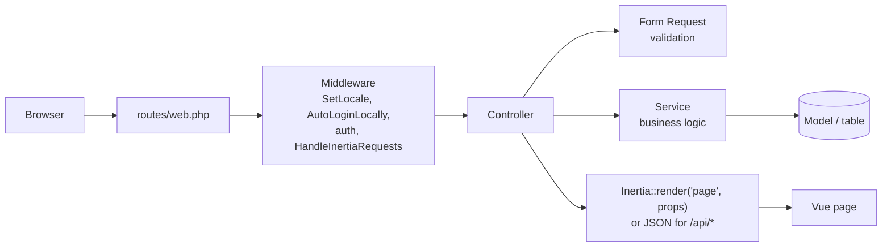

# Backend (Laravel)

All PHP code is in `app/`. The usual path of a request:

- **Pages** are returned with `Inertia::render()`: Laravel sends the name of a Vue page (`resources/js/pages/...`) and its data (props); Vue draws it. No separate REST API is needed for pages.
- **`/api/*` routes** return JSON. They are called with `fetch` by the exercises while you play (practice time, results, settings, vision tests). They use the same login session and CSRF token as the pages.

## Routes (`routes/web.php`)

| Method + URL | Controller | What it does |
|---|---|---|
| `GET /` | `DashboardController` | Home: today, program of the day, 14 days, vision progress, journal, exercises |
| `GET /exercitii` | `ExerciseController@index` | List of exercises |
| `GET /exercitii/{slug}` | `ExerciseController@show` | One exercise page + its previous results |
| `GET /calibrare` | `ExerciseController@calibration` | Calibration (glasses, Worth test, eye balance, screen size) |
| `GET /exercitii-fizice` | `ExerciseController@physical` | Physical (off-screen) exercises |
| `GET /test-vedere` | `VisionTestController@index` | Vision tests: monthly comparison, charts, history |
| `GET /test-vedere/{type}` | `VisionTestController@create` | Run a test: `acuity`, `reading`, `contrast` |
| `PATCH /test-vedere/{id}` | `VisionTestController@update` | Save the note of a test |
| `DELETE /test-vedere/{id}` | `VisionTestController@destroy` | Delete a test |
| `GET /rapoarte` | `ReportController@index` | Reports (`?perioada=7/30/90/365/toate` or `?luna=2026-11`) |
| `GET /rapoarte/export` | `ReportController@export` | CSV download of the period |
| `GET /setari`, `PUT /setari` | `SettingsController` | Settings page / save |
| `PUT /setari/parola` | `SettingsController@updatePassword` | Change password (only when login is on) |
| `PUT /jurnal` | `JournalController@update` | Save the day's journal |
| `GET /ghid` | (page `Guide`) | Guide: program, safety, how it works, sources |
| `PUT /locale` | `LocaleController@update` | Language: `ro` / `en` |
| `GET/POST /login`, `POST /logout` | `Auth\LoginController` | Login / logout |
| `GET/POST /register` | `Auth\RegisterController` | New account (only with `REGISTRATION_ENABLED=true`) |
| `POST /api/practice` | `PracticeController@store` | Add practice seconds (max 120 per call) |
| `POST /api/results` | `ExerciseResultController@store` | Save a finished round |
| `GET/PUT /api/settings` | `SettingsController` | Read / save settings (JSON) |
| `POST /api/vision-tests` | `VisionTestController@store` | Save a vision test, returns the comparison |

All routes except login / register / locale need a logged-in user (`auth` middleware).

## Models (`app/Models`)

| Model | Table | Relations / notes |
|---|---|---|
| `User` | `users` | `settings()` hasOne, `practiceLogs()`, `exerciseResults()`, `visionTests()`, `journalEntries()` hasMany |
| `UserSetting` | `user_settings` | `data` cast to array |
| `PracticeLog` | `practice_logs` | seconds per day + exercise |
| `ExerciseResult` | `exercise_results` | `toClient()` → `{g, t, d, ...data}` for the exercise pages |
| `VisionTest` | `vision_tests` | `type` → `VisionTestType`, `eye` → `Eye` (enums); `toClient()` |
| `JournalEntry` | `journal_entries` | `toClient()` |

Models use Laravel 13 attributes: `#[Fillable([...])]`, `#[Hidden([...])]`.

## Enums (`app/Enums`)

- `Eye`: `right`, `left`, `both` + `label()` (translated).
- `VisionTestType`: `acuity`, `reading`, `contrast` + `label()`, `page()` (Vue page), `lowerIsBetter()`, `noise()` (measurement error used by the comparison: 0.1 logMAR, 0.15 logCS).

## Controllers (`app/Http/Controllers`)

Thin: they validate (Form Request), call a service and return a page or JSON.

- `DashboardController` — collects everything for the home page from the services.
- `ExerciseController` — finds the exercise in `ExerciseCatalog` and renders its page with `results` (previous results of the exercise and of the extra series it needs, e.g. `balance`).
- `PracticeController`, `ExerciseResultController` — JSON endpoints used during exercises.
- `VisionTestController` — overview, test pages, save (+ comparison), note, delete (only your own tests: 403 otherwise).
- `ReportController` — report page and CSV export (`;` separator, UTF-8 BOM so Excel shows diacritics).
- `SettingsController` — settings page, save (JSON or redirect), password.
- `JournalController`, `LocaleController`.
- `Auth\LoginController`, `Auth\RegisterController`.

## Form Requests (`app/Http/Requests`)

Validation lives here, not in controllers: `PracticeRequest`, `ExerciseResultRequest` (+ `cleanData()` that keeps only safe keys), `SettingsRequest` (rules in `SettingsService::rules()`), `PasswordRequest`, `VisionTestRequest` (+ `details()`), `JournalRequest`, `LoginRequest` (+ `authenticate()` with a limit of 5 wrong tries per email + IP).

## Services (`app/Services`) — the business logic

| Service | Responsibility |
|---|---|
| `SettingsService` | Defaults + saved settings, validation rules, type normalisation |
| `ProgressService` | Add practice seconds, totals per day, streak / best streak, per-exercise summaries, recent results |
| `DailyPlanService` | "Today's program": game of the day, precision exercise of the day, relief / convergence on alternate days, calibration and weekly-test reminders |
| `ReportService` | Period from the query string, report data (days, totals, results, tests, notes), CSV rows |
| `VisionProgressService` | Day averages per test and eye, "now vs. one month ago" and "since the first test" comparisons with a verdict |

## Middleware (`app/Http/Middleware`)

- `SetLocale` — language from the session / cookie (`lazyeye_locale`), Romanian by default.
- `AutoLoginLocally` — when login is off (see below) signs you in as the admin user, creating it if needed.
- `HandleInertiaRequests` — data shared with every page: `auth` (user, `loginRequired`), `locale`, `settings`, `todaySeconds`, `flash`.

## Support (`app/Support`)

- `ExerciseCatalog` — the list of exercises (slug, group, Vue page, texts). One place for URLs, practice keys and result keys.
- `AuthMode` — `loginRequired()` / `bypass()`. The login page is skipped **only** when `AUTH_ENABLED=false` **and** `APP_ENV=local`. On the live server (`APP_ENV=production`) login is always required, whatever `.env` says.

## Configuration (`config/eye.php`, `.env`)

| `.env` | Meaning |
|---|---|
| `AUTH_ENABLED` | `false` locally (no login), `true` on the live server |
| `REGISTRATION_ENABLED` | Allow new accounts from the login page (default `false`) |
| `ADMIN_NAME`, `ADMIN_EMAIL`, `ADMIN_PASSWORD` | Admin user created by `php artisan db:seed` (and locally on first visit) |
| `APP_LOCALE` | Default language (`ro`) |
| `APP_TIMEZONE` | `Europe/Bucharest` — decides which day the practice time belongs to |

## Console

- `php artisan app:user email@example.com --name="Ana"` — create a user or change the password (asks for it hidden).
- `php artisan db:seed` — create / update the admin from `.env`.

## Translations

Text in PHP is English and goes through `__()`. Romanian is in `lang/ro.json` (shared with the Vue side) and `lang/ro/*.php` (validation and auth messages).
