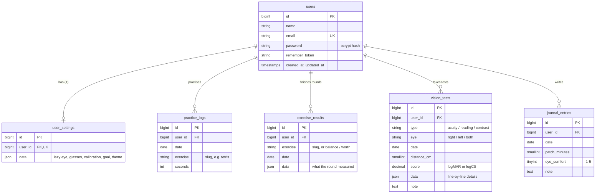

# Database

Locally the app uses **SQLite** (`database/database.sqlite`); on the live server **MySQL**. The migrations are the same for both (see `database/migrations`).

Every table of the app belongs to a user (`user_id`), so several people can use the same installation and each one sees only their own data. Deleting a user deletes all their rows (`cascadeOnDelete`).

> Days (`date` columns) are stored as text `YYYY-MM-DD` in the app's time zone (`Europe/Bucharest`). That keeps filters like "between 1 and 30 November" identical in SQLite and MySQL.

## Diagram

## Tables of the app

### `user_settings` — model `App\Models\UserSetting`

One row per user. `data` (JSON) holds the exercise settings; missing keys take the defaults from `config/eye.php` (`default_settings`). Read and written only through `App\Services\SettingsService`.

| Key in `data` | Type | Default | Meaning |
|---|---|---|---|
| `lazyEye` | `left` / `right` | `right` | The amblyopic eye |
| `viewMode` | `anaglyph` / `patch` | `anaglyph` | Red-cyan glasses, or the good eye covered |
| `redSide` | `left` / `right` | `left` | Eye behind the red lens |
| `otherLens` | `cyan` / `blue` / `green` | `cyan` | Colour of the second lens |
| `redLevel`, `otherLevel` | 40–255 | 255 | Brightness of each colour (lower = less ghosting) |
| `fellowContrast` | 0.1–1 | 0.3 | Contrast for the good eye in the dichoptic games |
| `autoBalance` | bool | true | Games adjust `fellowContrast` after each game |
| `dailyGoalMin` | 5–240 | 30 | Daily goal in minutes |
| `breakEveryMin` | 0–120 | 20 | Eye-break reminder (0 = off) |
| `sound` | bool | true | Beeps on correct / wrong |
| `pxPerMm` | 1–30 | 3.78 | Screen size from the calibration (CSS pixels per millimetre) |
| `distanceCm` | 20–700 | 60 | Usual distance to the screen during exercises |
| `calibrated`, `sizeCalibrated` | bool | false | Calibration done / screen size measured |
| `theme` | `light` / `blue` / `dark` | `light` | Colour theme of the interface |

### `practice_logs` — model `App\Models\PracticeLog`

Practice time. **One row per user + day + exercise** (unique index). While an exercise is running the page sends the seconds every 15 s (`POST /api/practice`) and `ProgressService::addSeconds()` adds them to `seconds`.

- `exercise` is a slug from `App\Support\ExerciseCatalog` (`tetris`, `contrast`, `convergenta`, …) or `test-vedere` (time spent on vision tests).
- Daily totals, the 14-day chart, the streak and the reports are sums of this table.

### `exercise_results` — model `App\Models\ExerciseResult`

One row per **finished round or game**. `data` is free-form JSON, different per exercise (the request keeps only short keys with numbers, short texts, booleans or small lists). The pages receive results in the flat shape `{ g: exercise, t: timestamp ms, d: 'YYYY-MM-DD', ...data }` (`ExerciseResult::toClient()`).

| `exercise` | Main keys in `data` |
|---|---|
| `tetris`, `breakout`, `sarpe` | `score`, `level`, `lines` / `length`, `fc` (good-eye contrast), `mode` |
| `contrast` | `thr` (threshold, 0–1), `cs` (sensitivity), `sf` (cycles/degree), `trials`, `acc` |
| `litera-e` | `stroke`, `mar`, `logMAR`, `decimal`, `crowd` (with/without neighbours), `atFloor`, `trials`, `acc` |
| `vernier` | `arcsec`, `px`, `trials`, `acc` |
| `inel` | `score`, `found`, `misses`, `minStroke`, `mar`, `decimal` |
| `relief` | `arcsec`, `px`, `trials`, `acc`, `ceiling`, `atFloor` |
| `citire` | `logmar_easy`, `logmar_min`, `wpm`, `texts`, `read` |
| `convergenta` | `kind: measure` → `bo_break`, `bo_recovery` (prism dioptres); `kind: train` → `max_bo`, `jumps`, `ok`, `avg_ms` |
| `fara-ecran` | `kind: npc` → `break_cm`, `recovery_cm`; other kinds → `seconds` |
| `balance` | `v` (new good-eye contrast), `reason` — written whenever `fellowContrast` changes |
| `worth` | `seen` — answer of the Worth 4-dot test in the calibration |

All of them also store `mode` (`anaglyph` / `patch`) so a comparison can warn when the mode changed.

### `vision_tests` — model `App\Models\VisionTest`

One row per **vision test and eye** (enums `App\Enums\VisionTestType`, `App\Enums\Eye`).

| Column | Meaning |
|---|---|
| `type` | `acuity` (letter chart), `reading` (reading test), `contrast` (contrast test) |
| `eye` | `right`, `left`, `both` |
| `distance_cm` | Distance used (always use the same one to compare) |
| `score` | Main number. Acuity and reading: **logMAR** (lower = better, 0.0 = normal, 1 line = 0.1). Contrast: **logCS** (higher = better) |
| `data` | Details: tested lines and typed letters, `letters_correct`, reading speeds (`max_wpm`, `cps`), contrast triplets, screen calibration used |
| `note` | Free note (tired, new glasses…) |

The monthly comparison is computed, not stored: `App\Services\VisionProgressService` (see [vision-tests.md](vision-tests.md)).

### `journal_entries` — model `App\Models\JournalEntry`

One row per user and day (unique): patching minutes done **outside** the app, how the eyes felt (1–5) and a note. Written from the home page (`PUT /jurnal`), shown on the reports.

## Laravel's own tables

| Table | Used for |
|---|---|
| `users` | Accounts (`App\Models\User`). Locally the admin from `.env` is created automatically. |
| `password_reset_tokens` | Laravel default (not used by a page yet) |
| `sessions` | Login sessions (`SESSION_DRIVER=database`) |
| `cache`, `cache_locks` | Cache and the login rate limiter |
| `jobs`, `job_batches`, `failed_jobs` | Laravel queue (not used yet) |
