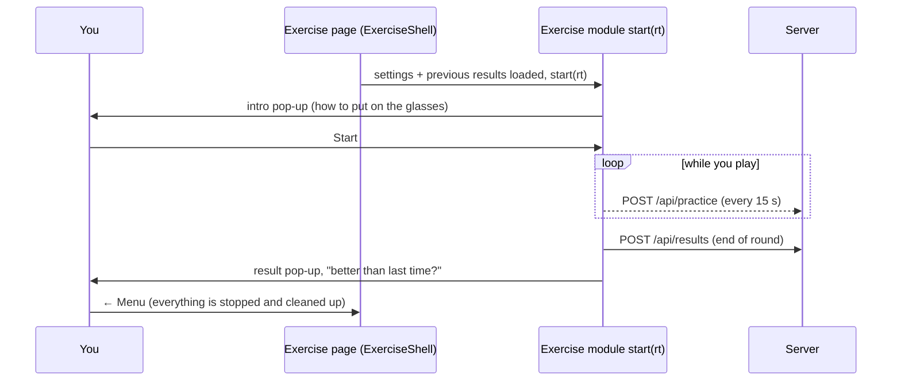

# Exercises

This page explains every exercise of the app: what it trains, what you do, how it gets harder, which eye sees what, and what is saved.

- How the Vue side runs an exercise (pages, frames, the `Amb` helpers in detail): [frontend.md](frontend.md).
- The vision tests (letter chart, reading, contrast) are not exercises. They are explained in [vision-tests.md](vision-tests.md).
- Tables and API calls: [database.md](database.md) and [backend.md](backend.md).

> **Honest note.** The exercises *add to* the treatment of the eye doctor. They do not replace it. The studies are summarised in the app's guide (`/ghid`, section "What the studies say"). In short: many people improve, not everyone, and in adults the gains are usually modest.

## The groups

The list of exercises is in `app/Support/ExerciseCatalog.php`. Each exercise has a **group**:

| Group | Name in the app | Idea |
|---|---|---|
| `dichoptic` | Games with both eyes | **Dichoptic** = each eye sees different pieces of the same game, through red-cyan glasses. You can only play if the brain uses *both* eyes. The good eye gets a fainter picture, so it does not "cover" the lazy eye. |
| `mono` | Precision exercises | **Perceptual learning** = a fine visual task, repeated many times, always at the limit of what you can see. Only the lazy eye works (the good eye is covered by the glasses colour or by a patch). |
| `stereo` | Depth vision | Training of **stereopsis** (seeing depth with two eyes). Needs the glasses. |
| `vergence` | Strabismus / convergence | **Vergence** = both eyes turn together, in (convergence) or out (divergence). For convergence problems and an eye that drifts outward. |
| `setup` | — | The calibration. It is not shown in the exercise lists. |

## Table

Paths are relative to `resources/js/`. "Romanian texts" is the dictionary file of the exercise (see i18n in [frontend.md](frontend.md#languages-i18n)).

| Slug | Title | Group | URL | Module | Page | Romanian texts |
|---|---|---|---|---|---|---|
| `calibrare` | Calibration | setup | `/calibrare` | `exercises/calibration.ts` | `pages/exercises/Calibration.vue` | `i18n/ro/calibration.ts` |
| `tetris` | Dichoptic Tetris | dichoptic | `/exercitii/tetris` | `exercises/tetris.ts` | `pages/exercises/Tetris.vue` | `i18n/ro/tetris.ts` |
| `breakout` | Dichoptic Breakout | dichoptic | `/exercitii/breakout` | `exercises/breakout.ts` | `pages/exercises/Breakout.vue` | `i18n/ro/breakout.ts` |
| `sarpe` | Dichoptic Snake | dichoptic | `/exercitii/sarpe` | `exercises/snake.ts` | `pages/exercises/Snake.vue` | `i18n/ro/snake.ts` |
| `relief` | 3D relief | stereo | `/exercitii/relief` | `exercises/stereo.ts` | `pages/exercises/Stereo.vue` | `i18n/ro/stereo.ts` |
| `contrast` | Fine contrast | mono | `/exercitii/contrast` | `exercises/contrast.ts` | `pages/exercises/Contrast.vue` | `i18n/ro/contrast.ts` |
| `litera-e` | Letter E | mono | `/exercitii/litera-e` | `exercises/letterE.ts` | `pages/exercises/LetterE.vue` | `i18n/ro/letterE.ts` |
| `vernier` | Aligned lines | mono | `/exercitii/vernier` | `exercises/vernier.ts` | `pages/exercises/Vernier.vue` | `i18n/ro/vernier.ts` |
| `inel` | Open ring | mono | `/exercitii/inel` | `exercises/ring.ts` | `pages/exercises/Ring.vue` | `i18n/ro/ring.ts` |
| `citire` | Reading with the lazy eye | mono | `/exercitii/citire` | `exercises/reading.ts` | `pages/exercises/Reading.vue` | `i18n/ro/reading.ts` |
| `convergenta` | Convergence training | vergence | `/exercitii/convergenta` | `exercises/vergence.ts` | `pages/exercises/Vergence.vue` | `i18n/ro/vergence.ts` |
| `fara-ecran` | Physical exercises (off screen) | vergence | `/exercitii-fizice` | `components/physical/*` | `pages/physical/Index.vue` | `i18n/ro/physical.ts` |

The titles, descriptions and "trains" texts of the cards come from the catalog (PHP). Their Romanian is in `lang/ro.json`.

## What all exercises share

### Red-cyan glasses or patch

The setting **"How you work"** (`viewMode`) decides how the good eye is kept out:

- `anaglyph` — **red-cyan glasses**. A red lens lets only red light through, a cyan lens only green + blue light. So a red drawing on black is seen by one eye only, a cyan drawing by the other eye only. The app knows which eye wears which lens (`redSide`, `otherLens` = cyan / blue / green).
- `patch` — the good eye is **covered** (patch or palm). The exercises use normal colours.

The helpers in `resources/js/amb/display.ts` choose the colours (details in [frontend.md](frontend.md#the-amb-module)):

| Helper | With glasses | With patch |
|---|---|---|
| `Amb.paint('lazy', colour)` | the lazy eye's lens colour, full strength | `colour` |
| `Amb.paint('fellow', colour)` | the good eye's lens colour × `fellowContrast` | `colour` |
| `Amb.paint('both', colour, k)` | grey (`k` × white), seen by both eyes | `colour` |
| `Amb.monoColors()` | black background, lazy-eye colour | white background, black |
| `Amb.channelMask()` | only the lazy eye's colour channels | all channels |

The game area (the **stage**) is always **black**, in every colour theme: the glasses separate the two pictures well only on black.

### The good eye's contrast and auto-balance

`fellowContrast` (0.1 – 1, default 0.3) is how strong the good eye's picture is in the dichoptic games. You find a starting value in the calibration (step 4). You can also change it in the settings (− / +).

When **"Adjusted automatically after every game"** (`autoBalance`) is on and you use the glasses, the games change it by **±0.05** with `Amb.adjustFellow()`:

- a good game → **up** (the eyes work in better balance, the good eye may see more);
- a very short game → **down** (the lazy eye may have been switched off by the brain).

Each change is also saved as a result of the series **`balance`**: `{ v, reason }` (`reason` = the slug of the game, `calibrare` or `manual` from the settings page).

### Adaptive difficulty (staircase)

The precision exercises use `Amb.Staircase` (`resources/js/amb/staircase.ts`). It is a classic *staircase*:

- A **correct** answer makes the task harder, a **wrong** answer makes it easier. Before the first mistake, every correct answer goes one step down (fast start). After that, `down` correct answers in a row are needed (e.g. 3 → you end up at about 79 % correct).
- Two modes: **continuous** (`start`, `min`, `max`; steps in log10 units `stepsLog`, smaller after each reversal) or **discrete** (`levels`, an ascending list, start at `startIndex`).
- A **reversal** is a change of direction (harder → easier or the other way). The round ends after `maxTrials` answers or `maxReversals` reversals.
- **Threshold** = geometric mean of the last reversals (the first two are skipped when there are enough).
- `atFloor` = you reached the smallest value the screen can show.

### Practice time and the break reminder

Every exercise calls `Amb.startTracking(slug, { onPause })` at the start and `Amb.setActive(true / false)` while you really play (`resources/js/amb/tracking.ts`):

- Each active second (tab visible, no pop-up break) is counted. Every 15 s the seconds are sent to `POST /api/practice`, and once more when the page closes.
- If a call fails (no internet), it is kept in the browser and sent later (`lib/http.ts`).
- **Break reminder:** after `breakEveryMin` minutes of active time (default 20, 0 = off), a pop-up asks you to look far away for 20 seconds. The game is paused (`onPause`). The "I took the break" button works after the 20 s.

The calibration does not count practice time. The vision tests count as `test-vedere`.

### Results

At the end of a round the exercise calls `Amb.saveResult(slug, data)`. It is sent to `POST /api/results` and stored in `exercise_results` (see [database.md](database.md)). The server adds `g` (slug), `t` (time in ms) and `d` (day). It keeps only short keys with numbers, short texts, booleans or small lists — **`null` values are not stored**.

The page gets the previous results in its `results` prop (oldest first). Some pages also get extra series (`ExerciseCatalog::extraResultKeys`): the games get `balance`, the calibration gets `worth` + `balance`, relief and convergence get `worth`.

Almost every result has `mode` (`anaglyph` / `patch`), so a comparison with "last time" can say when the way of working was different.

### Life of an exercise page

---

## Calibration (`calibrare`)

**Why.** The exercises need to know which eye is lazy, how your glasses work and how big your screen really is. Do it once, in the light you usually exercise in, and repeat it when something changes (glasses, screen, room).

**Steps.**

1. **Eyes and glasses** — lazy eye (left / right), how you work (glasses / patch), which eye has the red lens, colour of the other lens (cyan / blue / green). Steps 2–4 only matter for the glasses.
2. **Colour test** — a red and a cyan square. Close one eye at a time: each eye must see only its own square. If you still see a faint shadow of the other square ("ghosting"), lower its brightness with the sliders (`redLevel`, `otherLevel`, 80–255).
3. **Worth 4-dot test** — a classic fusion test: 1 red, 2 cyan and 1 white dot. With both eyes open you should see **4** dots (fusion). 2 dots = only the red-lens eye works, 3 = only the other eye, 5 = double vision (possible strabismus, ask the doctor), "they alternate" = alternating suppression. The text explains the answer and says when the suppressed eye is the lazy one.
4. **Balance between the eyes** — a horizontal bar for the lazy eye and a vertical bar for the good eye, with a white square in the centre. Lower the good eye's contrast until you see the whole cross. This is the starting `fellowContrast` of the games.
5. **Screen size and distance** — hold a bank card (85.6 mm wide) against the screen and match the rectangle (`pxPerMm`). Enter the distance from your eyes to the screen (`distanceCm`, 30–300 cm). The precision exercises and vision tests need both values.

"Done" sets `calibrated: true` and offers to go to the menu.

**Saved.**

- Series `worth`: `{ seen }` — `2`, `3`, `4`, `5` or `'alt'`.
- Series `balance`: `{ v, reason: 'calibrare' }` when you press "Save the balance".
- Settings (not results): `lazyEye`, `viewMode`, `redSide`, `otherLens`, `redLevel`, `otherLevel`, `fellowContrast`, `pxPerMm`, `distanceCm`, `sizeCalibrated`, `calibrated`.

**Files.** `exercises/calibration.ts`, `pages/exercises/Calibration.vue`, `i18n/ro/calibration.ts`.

---

## Dichoptic Tetris (`tetris`)

**Trains.** The two eyes working together and less **suppression** (the brain switching off the lazy eye). This is the "dichoptic game" approach studied by Hess, Thompson and colleagues. In children, a Cochrane review (2022) found binocular games about as good as patching, not clearly better. In adults the studies are smaller and the results mixed.

**What you do.** Normal Tetris: 10 × 20 cells. Arrows move and rotate, ↓ moves down, Space drops, P pauses. On touch screens there are buttons under the board.

**Eyes.**

| | With glasses | With patch |
|---|---|---|
| Falling piece and next piece | lazy eye, full contrast | normal colours |
| Pieces already placed | good eye, `fellowContrast` | normal colours |
| Grid and frame | both eyes (grey) — a "fusion lock" that helps the eyes stay aligned | normal |

**Difficulty.** The fall speed grows with the level: one step every `max(90, 850 × 0.85^(level−1))` ms. Level = 1 + lines / 10. Points: 100 / 300 / 500 / 800 × level for 1–4 lines.

**Auto-balance.** 10 or more lines → good eye +0.05. 2 lines or fewer → −0.05.

**Saved.** `{ score, lines, level, fc, mode }` (`fc` = the good eye's contrast during the game).

**Files.** `exercises/tetris.ts`, `pages/exercises/Tetris.vue`, `i18n/ro/tetris.ts`.

---

## Dichoptic Breakout (`breakout`)

**Trains.** Eye teamwork and eye–hand coordination. Same idea and same evidence as Tetris.

**What you do.** Move the paddle (mouse, finger, ← → or A D) and keep the ball in play. Space, ↑ or a click launches the ball. 3 lives. Each level has a new brick pattern; from level 3 the top two rows need two hits.

**Eyes.**

| | With glasses | With patch |
|---|---|---|
| Ball, bricks, sparks | lazy eye | colourful |
| Paddle | good eye, `fellowContrast` | blue |
| Frame (top, left, right) | both eyes | normal |

**Difficulty.** Ball speed = 330 + 35 per level (at most 650). More rows of bricks on higher levels (up to 8).

**Auto-balance.** Level cleared → +0.05. Game over on level 1 with less than 30 % of the bricks broken → −0.05.

**Saved.** At game over: `{ score, level, fc, mode }`. (A cleared level is not saved on its own.)

**Files.** `exercises/breakout.ts`, `pages/exercises/Breakout.vue`, `i18n/ro/breakout.ts`.

---

## Dichoptic Snake (`sarpe`)

**Trains.** Eye teamwork and visual attention. Same idea and evidence as the other games. This game is new (it was not in the first version).

**What you do.** Classic snake on a 20 × 16 grid: arrows or W A S D turn, Space or P pauses. On touch screens: on-screen arrows or a swipe on the board. Eat the round dots to grow. You lose when you hit the edge, an obstacle or your own tail.

**Eyes.**

| | With glasses | With patch |
|---|---|---|
| Snake (head + body) | lazy eye, full contrast | green |
| Food (round dots) and obstacles (squares with an X) | good eye, `fellowContrast` | red / grey |
| Border and faint grid | both eyes, dim grey | dim grey |

With the glasses, food and obstacles have the same colour, so they differ by **shape**.

**Difficulty.** Level = 1 + foods / 5. One step every `max(70, 170 × 0.9^(level−1))` ms. From level 2 short walls (2–3 cells) appear: 3 at level 2, one more per level, at most 10. They never touch the border or each other (so every free cell stays reachable), and never appear near the head or right in front of it.

**Auto-balance.** 10 or more foods → +0.05. 2 foods or fewer → −0.05.

**Saved.** `{ score, length, level, fc, mode }`.

**Files.** `exercises/snake.ts`, `pages/exercises/Snake.vue`, `i18n/ro/snake.ts`.

---

## 3D relief (`relief`)

**Trains.** Depth vision (**stereopsis**) and fusion. It follows the kind of training in Ding & Levi (2011): some adults with amblyopia and no stereo vision got part of it back after stereo perceptual learning. It was a small study.

**What you see and do.** A field of random dots. Each eye gets its own copy. A square of dots above, below, left or right of the centre is shifted in one eye's copy, so it seems to float in front of the screen. **Each eye alone sees only random dots** — the square exists only when the brain joins the two pictures. Answer where the square is (arrows or 1–4). A white cross and frame, seen by both eyes, help the eyes stay aligned.

**Eyes.** Needs the glasses: the left-eye picture is drawn in the left lens colour, the right-eye picture in the right lens colour, added on black. **In patch mode the exercise is blocked** (it cannot work with one eye).

**Difficulty.** Discrete staircase on the shift (**disparity**) in whole screen pixels: from about 20 arcmin down to 1 px, steps about 25 % apart, `down: 2` (≈ 71 % correct; chance is 25 %), at most 50 answers or 10 reversals.

**Saved.** `{ px, arcsec, trials, acc, ceiling, atFloor, mode }`. `ceiling` = you did not see the square even at the biggest shift (common at the start). The page also reads the last `worth` result to warn about double vision.

**Files.** `exercises/stereo.ts`, `pages/exercises/Stereo.vue`, `i18n/ro/stereo.ts`.

---

## Fine contrast (`contrast`)

**Trains.** **Contrast sensitivity** of the lazy eye — seeing faint, low-contrast shapes. Perceptual learning with this kind of stimulus (Polat and others, reviewed by Levi & Li 2009) improved contrast sensitivity and sometimes acuity in adults; the gains vary a lot.

**What you see and do.** A striped round blob (a **Gabor patch**) on a grey background, tilted left ╲ or right ╱. Say which way (← / →). You choose the stripe size (1.5–12 cycles per degree) and how long it is shown (0.3 s, 0.5 s, 1 s or until you answer).

**Eyes.** With glasses the grey and the stripes are drawn only in the lazy eye's colour channels (`channelMask`), so the good eye sees almost black. With the patch: normal grey. The grey is **dithered** (tiny random noise) so very small contrasts are still correct on an 8-bit screen.

**Difficulty.** Continuous staircase on the contrast: start 30 %, min 0.4 %, `down: 3`, steps 0.3 / 0.15 / 0.1 log, at most 70 answers or 12 reversals.

**Saved.** `{ thr, cs, sf, trials, acc, mode }` — `thr` = contrast threshold (0–1), `cs` = sensitivity (1 / thr), `sf` = stripe frequency. "Last time" compares only rounds with the same `sf`.

**Files.** `exercises/contrast.ts`, `pages/exercises/Contrast.vue`, `i18n/ro/contrast.ts`.

---

## Letter E (`litera-e`)

**Trains.** **Visual acuity** (seeing small details) and **crowding** — in a lazy eye, letters close together run into each other. Perceptual learning with letters has shown modest acuity gains in adults (around 1–2 lines on a chart); the results differ from person to person.

**What you see and do.** A letter E that points up, down, left or right. Answer with the arrows. Optional neighbours: none, one letter away, or close (crowding).

**Eyes.** `monoColors()`: with glasses a lazy-eye-colour E on black; with the patch a black E on white.

**Difficulty.** Discrete staircase on the stroke width in screen pixels (the letter is 5 strokes tall): 1, 2, 3 … 16, 20 px, start at 14 px, `down: 2`, at most 48 answers or 10 reversals.

**Saved.** `{ stroke, mar, logMAR, decimal, crowd, atFloor, trials, acc, mode }`. `mar` = the stroke in minutes of arc (minimum angle of resolution); `decimal` = 1 / mar. These are training estimates — the real acuity test is the letter chart ([vision-tests.md](vision-tests.md)). "Last time" compares only rounds with the same crowding.

**Files.** `exercises/letterE.ts`, `pages/exercises/LetterE.vue`, `i18n/ro/letterE.ts`.

---

## Aligned lines (`vernier`)

**Trains.** **Hyperacuity** — seeing tiny shifts in position, much finer than one cell of the retina. Vernier acuity is often strongly reduced in amblyopia and it is a classic perceptual learning task (Levi & Li 2009).

**What you see and do.** Two vertical lines, one above the other. The lower one is shifted a little to the left or right. Answer ← or →. Small random jumps of the pair stop you from using the screen edge as a reference.

**Eyes.** `monoColors()` (lazy eye only, as for Letter E).

**Difficulty.** Continuous staircase on the shift in screen pixels: start 6 px, down to 0.15 px (shifts smaller than a pixel are drawn with anti-aliasing), `down: 3`, at most 60 answers or 12 reversals.

**Saved.** `{ px, arcsec, trials, acc, mode }` — `arcsec` = the threshold in seconds of arc (needs a good calibration).

**Files.** `exercises/vernier.ts`, `pages/exercises/Vernier.vue`, `i18n/ro/vernier.ts`.

---

## Open ring (`inel`)

**Trains.** Acuity, **visual search** and eye movements, against the clock. Landolt rings (a ring with a gap, the "C" of eye charts) are a standard acuity target.

**What you see and do.** A board of closed rings with **one** open ring (gap in one of 8 directions). Click or tap it as fast as you can. A round lasts 60 s. If you do not find it in 12 s, the app shows where it was.

**Eyes.** `monoColors()` (lazy eye only).

**Difficulty.** Not a staircase but a simple rule on the stroke width: × 0.85 after a hit, × 1.15 after a wrong click, × 1.2 after a timeout (always between 1 screen pixel and 14 CSS pixels). Points = 10 + 40 / size in arcmin + a time bonus.

**Saved.** `{ score, found, misses, minStroke, mar, decimal, mode }` — the smallest ring found, in screen pixels and in arcmin.

**Files.** `exercises/ring.ts`, `pages/exercises/Ring.vue`, `i18n/ro/ring.ts`.

---

## Reading with the lazy eye (`citire`)

**Trains.** Reading, crowding and stamina of the lazy eye — the skill people use most in daily life. There is less research on reading practice than on the other tasks; its value is mostly practical.

**What you see and do.** A round has 5 short everyday texts (written for the app, Romanian or English). Read each one, stop the clock, then say how it went: **easy**, **with effort** or **could not read it**.

**Eyes.** `monoColors()` (lazy eye only).

**Difficulty.** The print size is set in **logMAR** at your distance (x-height = 5 arcmin × 10^logMAR; logMAR 0 ≈ what a healthy eye reads). "Easy" makes the next text 0.1 smaller, "with effort" keeps the size, "could not read" makes it 0.1 bigger. Range 1.0 … −0.1. The next round starts 0.1 above your last easy size (first round: 0.7).

**Saved.** `{ logmar_easy, logmar_min, wpm, texts, read, mode }` — smallest easy size, smallest size read at all, reading speed in words per minute. (`logmar_easy` is missing when no text was easy, because `null` is not stored.)

**Files.** `exercises/reading.ts`, `pages/exercises/Reading.vue`, `i18n/ro/reading.ts`.

---

## Convergence training (`convergenta`)

**Trains.** **Convergence** (both eyes turning in for near) and control of an eye that **drifts outward** (exotropia). It works like the anaglyph "vectograms" orthoptists use. Evidence: in the CITT trials (children with convergence insufficiency), therapy at the clinic plus home practice worked best; computer exercises done only at home were not better than placebo. For intermittent exotropia a Cochrane review (2013) found too few good studies. The app says this on the intro screen.

**What you see and do.** Each eye sees its own copy of a round target in its lens colour. When the copies move apart "crossed" (base-out), the eyes must turn in to keep **one** picture; "uncrossed" (base-in) asks them to turn out. Two small marks, one per eye (**nonius** lines), show suppression: if one disappears, that eye switched off.

- **Measure:** the demand grows by 1 prism dioptre (Δ) every 1.5 s until the picture doubles (**break**), then shrinks until it is single again (**recovery**). First base-out, then optionally base-in.
- **Train (3, 4 or 5 min):** jumps between an easy 2 Δ and a harder target demand. After each jump a letter E is split between the eyes (one eye sees the spine, the other the bars). You can read its direction only when the target is joined and clear.

The separation on screen is `prism × distance / 100` (in mm), so the calibration (screen size and distance: 40, 50 or 60 cm) matters.

**Eyes.** Lazy eye's copy at full strength, good eye's copy at an adjustable brightness (40–100 %) for when the lazy eye's mark disappears. **Glasses only** — in patch mode the page explains why it cannot work and offers to switch.

**Difficulty.** Discrete staircase on the target demand in steps of 2 Δ (from 4 Δ up to what the screen allows, at most 45 Δ), `down: 2`. It starts at 60 % of your last measured break (8 Δ without a measurement). A correct answer makes the next jump harder only when it came within 6 s.

**Safety.** At most 10 minutes of exercise per visit. Three failed jumps in a row, even at the easy demand → a pop-up says to rest. If your last Worth test showed 5 dots (double vision), you must confirm a warning before you can start.

**Saved.** Two kinds of result:

- Measurement: `{ kind: 'measure', bo_break, bo_recovery, bo_supp, bo_limit, bi_break, bi_recovery, bi_supp, bi_limit, distance_cm, mode }` (`bo` = base-out, `bi` = base-in, `supp` = a mark disappeared, `limit` = the screen limit was reached before the break).
- Training: `{ kind: 'train', max_bo, jumps, ok, avg_ms, level, secs, distance_cm, mode }`.

**Files.** `exercises/vergence.ts`, `pages/exercises/Vergence.vue`, `i18n/ro/vergence.ts`.

---

## Physical exercises, off screen (`fara-ecran`)

**Trains.** Near convergence, control of the drifting eye, and patching — away from the screen. Honest note: in the CITT trials, pencil push-ups done only at home helped less than therapy at the clinic. The Brock string and the barrel card are common tools of orthoptists, with little direct research. The page shows "what the studies say" for each exercise.

**What is on the page.** An illustrated guide (`pages/physical/Index.vue`, content in `components/physical/guide.ts`, Romanian and English side by side). Each card (`GuideCard.vue`) has: what it is for, why it may help, the evidence, the steps, the dose, when to stop, line drawings (`PhysicalFigure.vue`, they follow the colour theme) and a timer (`PhysicalTimer.vue`):

1. **Brock string** — a string with coloured beads; you look at one bead and should see two strings crossing at it.
2. **Pencil push-ups** — bring a pencil tip slowly towards the nose until it doubles. Includes `NpcTracker.vue`: write down the **near point of convergence** (break and recovery in cm) and see it on a chart. In CITT a break of 6 cm or more counted as "receded" (not a diagnosis).
3. **Barrel card** — `BarrelCard.vue` draws a card in real millimetres (60 × 215 mm, fits A4) that you can print.
4. **Near – far** — switching focus between a near and a far target.
5. **Patching with near activities** — the long timer (1–2 h) is not counted as practice time; patching minutes go into the day's journal on the home page.
6. **Controlling the drifting eye.**
7. **20-20-20 breaks and blinking.**

**Practice time.** Only one timer runs on the page at a time (`components/physical/timer.ts`). While a timer runs (except patching and the 20-second break), the time counts as practice `fara-ecran`. The screen is kept on where the browser allows it.

**Saved.** Series `fara-ecran`:

- A timer session of at least 60 s: `{ kind, seconds }` — `kind` = `brock`, `pencil`, `barrel`, `nearfar`, `drift` …
- A near-point measurement: `{ kind: 'npc', break_cm, recovery_cm }` (`recovery_cm` is optional).

**Files.** `pages/physical/Index.vue`, `components/physical/*` (`guide.ts`, `timer.ts`, `GuideCard.vue`, `PhysicalTimer.vue`, `PhysicalFigure.vue`, `NpcTracker.vue`, `BarrelCard.vue`), `i18n/ro/physical.ts`.

---

## Where the results are shown

- **Exercise cards** (home page and `/exercitii`): one line of statistics per exercise, from `utils/exerciseStats.ts` ("Best score: 1200 · 8 rounds", "Last threshold: 12″" …).
- **Reports** (`/rapoarte`): one chart per exercise with the value followed over time, from `utils/metrics.ts` (e.g. Letter E → `decimal`, Contrast → `thr` in %, Vernier and relief → `arcsec`, games and Open ring → `score`, convergence → `bo_break` (or `max_bo`), physical exercises → the near point `break_cm`, the eye balance → `v` in %). For thresholds the axis is flipped, so **up always means better**.
- **Today's program** on the home page (`app/Services/DailyPlanService.php`): one dichoptic game and one precision exercise that change every day, relief and convergence on alternate days, plus reminders for the calibration and the weekly vision test.
